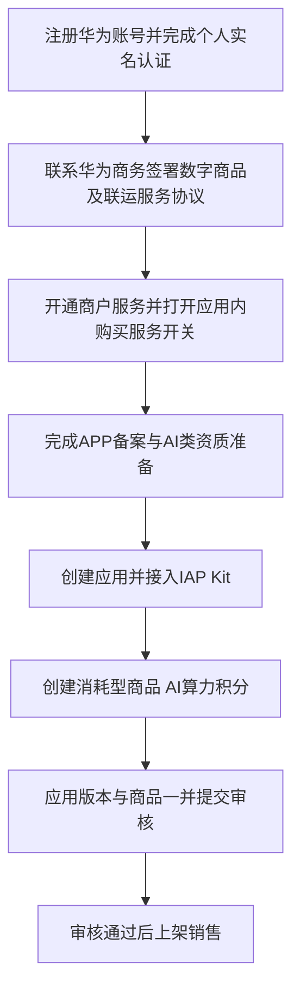
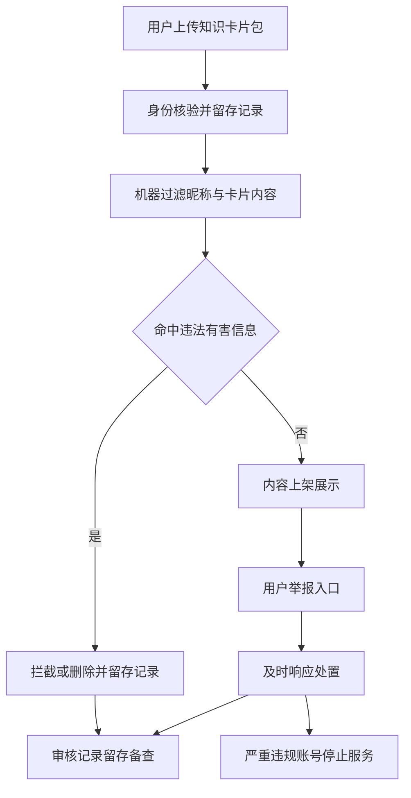
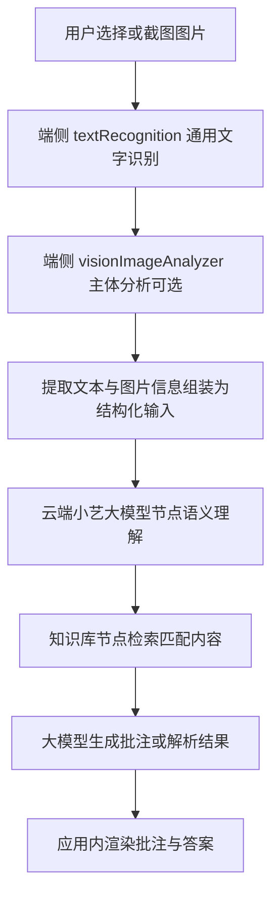

# 华为应用市场 AI 应用合规与开发接入整理

> 适用场景：个人开发者 / 个体工商户；生成式 AI 对话、知识库解析、图片 OCR、UGC 求卡广场、IAP 算力积分；接入小艺开放平台。
> 说明：本文为资料整理（DeepSeek 产出原文存档，2026-10-16 用户补发），不构成法律意见。最终以华为审核系统提示、主管部门认定和归属地网信部门要求为准。
> 用途：总方案 V4.0 的合规执行手册（细则/自查清单/官方链接以此文档为准）。

## 0. 结论速览

| 事项 | 结论 | 关键动作 |
|---|---|---|
| 个人开发者上架 AI 对话应用 | 可行 | 实名认证、签署数字商品协议、开通商户服务、完成 APP 备案 |
| 接入第三方已备案大模型 | 仍需关注自身服务提供者义务 | 提供上游模型上线备案号 + 算法备案号；必要时自行安全评估/算法备案 |
| 接入小艺开放平台大模型 | 备案填报可简化 | 大模型备案信息可填"否"；但 AI 标识、安全评估等不自动免除 |
| IAP 售卖 AI 算力积分 | 符合消耗型商品 | 仅应用内使用、不可提现、不可转让、不得第三方支付 |
| 积分命名 | 避免金融/虚拟货币联想 | 用"算力积分""AI 积分""积分礼包"等 |
| UGC 功能 | 开发者承担内容管控主体责任 | 身份核验、内容过滤、举报响应、违规处置、联系方式公示 |
| 求卡广场 | 属信息发布/舆论属性功能 | 需《安全评估报告》并提交网信、公安 |
| 审计日志 | 华为审核未明确字段/时长 | 法规通用要求：网络日志不少于 6 个月；具体以网信要求为准 |
| 数据存储 | 面向中国大陆公众应境内存储 | 华为云/阿里云中国大陆节点；隐私政策与实际一致 |
| 未成年人保护 | 仅写隐私条款不够 | 学习类建议青少年模式、儿童隐私政策、监护人同意流程 |
| 小艺开放平台 | 个人可接入部分能力 | LLM 模式 / 云工作流 / OCR 插件可用；A2A、付费 Agent 等多限企业 |
| 费用 | 平台接入目前不收费 | 无公开 token 价目表；IAP 收入与模型费用两条独立账单 |

---

## 1. 主体资质与接入路径

### 1.1 个人 / 个体工商户可行性

个人开发者可以上架生成式 AI 对话类应用，也可以通过华为 IAP 售卖消耗型数字商品。但需满足：

1. 完成个人实名认证：人脸识别、个人银行卡、身份证人工审核、华为云授权认证之一。
2. 签署《华为数字商品及联运服务协议》：中国大陆个人开发者可签约，免盖章但需身份证号；海外目前仅支持企业开发者。
3. 开通商户服务：配置银行卡、税务信息，用于接收分成收益。
4. 完成 APP 备案：工信部移动互联网应用程序核准备案，主体名称需与华为开发者名称一致。
5. AI 类专门资质：算法备案、安全评估、AI 生成内容标识、大模型备案信息等。

### 1.2 接入流程

### 1.3 重要提醒

- 应用内虚拟商品必须通过华为 IAP 销售，不得引导第三方支付。
- 积分仅限应用内使用、不可提现、不可转让。若支持提现、转让、玩家间交易，可能被认定为虚拟货币交易类应用，直接无法上架。
- 数字商品当前销售范围仅支持中国大陆。
- 首次提交数字商品或新增商品类型，必须随新应用版本一并提交审核，不能单独提交商品。
- 沙盒测试可在正式发布前模拟交易与退款，不产生费用。

---

## 2. AI 资质与内容合规

### 2.1 大模型备案信息填报

| 模型来源 | 填报要求 |
|---|---|
| 接入小艺开放平台提供的大模型 | 大模型备案信息可填"否"，无需开发者主体单独提供生成式 AI 上线备案号和算法备案号 |
| 接入非小艺开放平台的三方大模型 | 需填"是"，并提供生成式人工智能服务上线备案号、算法备案号，多个备案号用英文逗号分隔 |

小艺大模型已完成生成式人工智能服务备案：智慧助手（小艺）大模型，备案号 `Jiangsu-ZhiHuiZhuShou-20230911`。

但注意：若应用自身被认定为具有舆论属性或社会动员能力的生成式 AI 服务，仍应按《生成式人工智能服务管理暂行办法》开展安全评估并履行算法备案手续。

### 2.2 服务提供者与技术支持者

- 通过 API 接入豆包、DeepSeek 等模型并向公众提供对话服务，开发者属于"服务提供者"。
- 模型厂商属于"服务技术支持者"。
- 算法备案填报时按两种角色区分，服务提供者需填报主体信息、算法信息，并关联产品及功能信息。
- 上游模型已备案不能完全替代开发者作为服务提供者的合规义务。
- 建议提审前通过互动中心咨询客服，确认自身业务形态是否需要另行备案。

### 2.3 安全评估

具有舆论属性或社会动员能力的互联网信息服务，应在上线前自行或委托第三方开展安全评估，并通过全国互联网安全管理服务平台提交所在地网信部门和公安机关。

审核时提供：

- 《安全评估报告》及提交结果截图；
- 现场检查结果须为"通过"或审核状态为"审核通过"；
- 报告中的服务名称需与上传应用名称一致；
- 单位名称需与开发者名称一致；
- 报告尾页须申请人及评估单位签字、盖章。

"求卡广场"属于信息发布/信息分享类功能，涉及舆论属性，需提交《安全评估报告》。个人/个体工商户主体可以承接，但需落实内容管控机制。

### 2.4 AI 生成内容标识

标识分两类：

- 显式标识：在生成合成内容或交互界面中添加，以文字、声音、图形等方式呈现，用户可明显感知。
- 隐式标识：在生成合成内容文件数据/元数据中添加，不易被用户明显感知。

| 场景 | 显式标识 | 隐式标识 |
|---|---|---|
| 对话回复 | 界面需有可感知 AI 提示，如"内容由 AI 生成"角标 | 纯文本实时对话一般以界面标识为主 |
| 知识库解析 | 解析结果展示界面标注 AI 生成属性 | 若导出为文件，文件元数据需嵌入隐式标识 |
| AI 辅助生成卡片 | 卡片上需有文字/图形 AI 生成标识 | 若卡片以图片等文件形式保存/分享，需在文件元数据中嵌入隐式标识 |

要求：

- 接入小艺模型和接入第三方模型，AI 标识义务相同，不因模型来源简化。
- 应用包含 AI 生成合成内容时，需在 AGC 的"AI 功能声明"中选择"涉及"，并上传 AI 生成标识材料和相关资质文件。
- 若应用不提供生成内容导出/下载功能，仅需提供应用内显式标识截图。
- 若提供导出功能，还需隐式标识截图或通过 AI 标识服务检测平台检测获取合规证明。
- 不得提供恶意删除、篡改、伪造、隐匿生成合成内容标识的功能。

### 2.5 个人 / 个体工商户备案主体问题

法规上允许：算法备案中的"服务提供者"和《生成式人工智能服务管理暂行办法》中的服务提供者均包含"个人"。

实操注意：

- 华为审核要求《安全评估报告》服务名称与应用名称一致，单位名称与开发者名称一致。
- 个人主体需确保全链路主体信息一致。
- 算法备案和安全评估涉及自评估报告等材料，个人主体在网信部门的实际受理口径可能存在差异，建议提前向归属地网信部门咨询。

### 2.6 第三方模型所需材料

若接入第三方大模型，建议准备：

1. 上游模型生成式 AI 服务上线备案号、算法备案号及查询截图。
2. 与模型服务商的合作协议或授权文件。
3. AI 生成合成内容标识说明函。
4. 接入第三方大模型时，应要求服务方出具隐式标识截图，或通过人工智能生成合成内容标识服务平台检测获取合规证明。
5. 涉及多个生成合成场景的，提供多个场景标识截图。

---

## 3. IAP 积分商品合规

### 3.1 商品定性

AI 算力积分符合消耗型商品定义：随着使用减少，需要再次购买，例如游戏货币、游戏道具。

合规设计：

- 仅限应用内使用；
- 不可提现；
- 不可转让；
- 不具备变现、流通属性。

配置路径：HarmonyOS 开发者中心 > 应用管理 > 筛选待发布应用 > 应用上架 > 版本信息 > 应用内商品 > 添加商品。

### 3.2 命名规范

高风险表述：

- "虚拟货币""币"类表述；
- "充值"类表述单独使用；
- 占位符、乱码、表情符号、特殊符号、关键词堆砌。

建议表述：

- "算力积分"
- "AI 积分"
- "积分礼包"
- "学习积分"

商品描述中明确："积分仅限本应用内使用，不可提现、不可转让。"

### 3.3 退款规则

用户申请退款路径：

- 系统设置中找到应用订单申请；
- 应用内集成的退款入口申请。

开发者处理方式：

- 使用退款管理 API 自动返回退款意向、金额及原因；
- 或在 AppGallery Connect 退款管理页面人工审核；
- 同意退款时可输入可退款金额，支持部分退款；
- 不同意时可驳回并填写原因。

已部分消耗积分的订单：

- 可按未消耗部分比例反馈部分退款；
- 或结合订单实际情况驳回并说明原因，如"积分已消耗使用"。

用户协议可约定积分使用与退款政策，但不能完全排除用户通过系统设置发起退款申请的权利。驳回理由需合理真实。

建议在应用内显著位置公示积分规则：获取、消耗、有效期、退款政策。

### 3.4 打卡 / 任务 / UGC 赠送积分红线

需规避：

1. 刷量刷单：不得通过机器或人工刷粉、刷赞、刷票、刷量、刷单，不得利用兼职类应用发布下载任务。
2. 赌博与随机性玩法：不得含需投入法定货币参与的随机性玩法，如输赢、抽取、押注竞猜。任务奖励需确定性，避免"抽奖开箱"。
3. 个人信息保护：不得通过积分、奖励、优惠等方式欺骗误导用户提供身份证号码及个人生物特征信息。
4. UGC 收益变现边界：积分若可提现或兑换现金，可能触及赌博类或非法金融活动红线。保持积分仅限应用内消费。

合规设计建议：

- 使用"每日签到""学习任务""创作激励"等中性词汇；
- 避免"做任务赚钱""收益""提现"等表述；
- 所有任务奖励均为应用内积分，明示不可提现、不可转让；
- 任务内容限于本应用内行为：签到、学习、创作；
- 不涉及第三方应用下载、拉新注册、诱导分享；
- UGC 激励与内容质量挂钩，不设置"拉人头返利"结构。

### 3.5 创作者分成

开发者与创作者之间的内部分成比例，华为平台规则没有限制性规定。95%/5% 可由开发者自行制定并公示。

边界：

- 创作者收益同样只能是应用内积分；
- 不可提现、不可转让；
- 不得设置"拉人头返利"结构；
- 分成应与内容质量、下载量等正向指标挂钩；
- 若后续涉及任何形式变现，需自行评估税务申报义务。

---

## 4. UGC 与求卡广场合规

### 4.1 内容管控五项机制

开发者必须承担内容管控主体责任，缺一不可：

1. 身份核验机制：核验用户账号身份信息并保存记录。
2. 内容过滤机制：对账号名称、昵称、简介、备注、标识、信息发布、评论等功能及内容中的违法有害信息进行防范处置，并保存记录。
3. 举报响应机制：制定举报机制并及时响应。
4. 违规处置机制：实现服务关闭功能，对严重违规用户账号停止提供服务。
5. 联系方式公示：公布联系信息，便于用户联系。

对骚扰、歧视、恐吓或霸凌行为，也需设置过滤机制。

高风险场景：

- 用户昵称模块；
- AIGC 功能模块；
- 用户评论模块；
- 知识卡片包上传。

建议：卡片标题、简介、正文、用户昵称均接入审核，机器过滤 + 人工复审，并保留审核记录备查。

### 4.2 求卡广场定性

用户发布知识需求帖、其他用户浏览回应，构成公众信息发布渠道，属于信息发布/信息分享类功能，涉及舆论属性。

依据《具有舆论属性或社会动员能力的互联网信息服务安全评估规定》，开办论坛、博客、聊天室、信息分享等信息服务或附设相应功能的，属于具有舆论属性或社会动员能力的互联网信息服务。

因此：

- 需提交《安全评估报告》；
- 报告主体信息需一致；
- 个人/个体工商户可包含该功能，前提是完成安全评估并落实内容管控机制。

---

## 5. 数据、隐私与未成年人保护

### 5.1 审计日志

华为平台审核层面：未对生成式 AI 应用的审计日志字段、留存时长提出明确审核规定。审核时主要核验算法备案、安全评估报告、AI 内容标识等资质材料。

法规通用层面：

- 《网络安全法》要求网络运营者按照规定留存网络日志不少于六个月；
- 生成式 AI 服务实践中，监管部门通常要求留存覆盖用户注册信息、对话输入、模型输出等关键环节日志；
- 具体字段清单与留存时长，以归属地网信部门要求和《生成式人工智能服务安全基本要求》等技术标准为准。

### 5.2 数据存储地

面向中国大陆公众提供生成式 AI 服务，用户个人信息及服务日志应存储在中华人民共和国境内的服务器。

要求：

- 使用华为云或阿里云中国大陆节点符合境内存储要求；
- 若模型 API 调用经过境外中转节点，需确认用户输入内容不出境，或履行数据出境合规手续；
- 隐私政策中的存储地点描述须与实际部署一致。

### 5.3 未成年人保护

仅在隐私政策中说明保护条款不够，需区分：

1. 华为审核强制情形：网络游戏、网络直播、网络音视频、网络社交四类服务应设置时间管理、权限管理、消费管理等功能。学习类 AI 应用不在强制列举范围，但"求卡广场"若被认定具有社交属性，建议参照提供青少年模式。
2. 目标受众包含未成年人：须确保内容适合未成年人，遵守《未成年人保护法》。收集和使用儿童个人信息的应用应制定专门儿童隐私政策，收集前需获得父母或监护人合法授权。
3. 学习类 AI 应用专项红线：
   - 不得提供和传播"拍照搜题"等惰化中小学生思维能力的不良学习方法；
   - 不得包含"一对一""住家教师""众筹私教"等违规校外培训信息；
   - 不得通过即时通讯等方式有偿开展校外培训；
   - 面向未成年人的在线教育类应用不得含有网络游戏链接及与教学无关的广告推送；
   - 需建立便捷、合理、有效的投诉和举报渠道，公开投诉举报方式。

实操建议：主动提供青少年模式，包括内容池过滤、使用时长限制、消费限制；提供独立的未成年人/儿童隐私政策与监护人同意流程。

---

## 6. 小艺开放平台接入

### 6.1 个人开发者可用性

| 场景 | 推荐模式 | 个人开发者可用性 |
|---|---|---|
| 纯文本对话 | LLM 模式（单 Agent） | 可用，零代码配置提示词 |
| 长文档知识库解析 | LLM 模式 + 知识库，或云工作流模式 | 可用 |
| 图片 OCR | 云插件 OCR | 可用，但不支持输出结构化数据 |
| 图片内容理解（结构化） | MCP 插件，如个人证件照识别 | 暂限企业开发者，官方表示即将对个人开放 |

主体限制：

- 云 A2A 模式：定位为企业开发者，个人暂不适用。
- 端 A2A 模式：适用于已具备 HarmonyOS 端应用能力的开发者，需在 AGC 发布应用并通过 AgentExtensionAbility 接入，要求 API 24 及以上。个人能否开通以控制台实际入口为准。
- 智能体数字商品支付服务：付费 Agent 目前内测，仅企业开发者可用。
- MCP 插件上架：标准注册方式个人可创建；从魔搭等外部平台导入的插件仅支持本账号智能体渠道调试，无法公开发布。

### 6.2 备案简化

接入小艺开放平台提供的大模型：

- 大模型备案信息可填"否"；
- 无需开发者主体单独提供生成式 AI 上线备案号和算法备案号；
- 合规基础是小艺大模型已完成备案。

但以下不简化：

- AI 生成合成内容标识；
- AI 功能声明；
- 安全评估；
- 若自身被认定具有舆论属性或社会动员能力，仍需算法备案。

### 6.3 费用

- 小艺开放平台接入本身：官方社区回复为不收费。
- 目前无公开统一的 token 计费价目表。
- 小艺 Claw / 小艺 Work 面向终端用户的订阅产品采用 AI 点数计费，如体验包 49 元含 1000 点、标准包 199 元含 6000 点，与开发者接入无关。
- 端侧 Vision Kit 试用期免费政策至 2026 年 12 月 31 日，后续收费政策以官网通知为准。
- IAP 收入与模型费用是两条独立账单，当前无分成抵扣机制。
- 若另行使用华为云等付费 AI 服务，在对应云服务账户单独计费。

### 6.4 技术模式选择

对纯云端 AI 对话应用：

- 推荐 LLM 模式或云工作流模式；
- 不首选 A2A。

| 模式 | 适用场景 | 建议 |
|---|---|---|
| LLM 模式 | 简单对话、知识问答、基础内容生成 | 个人开发者首选，零代码 |
| 云工作流模式 | 多步骤协同、逻辑复杂 | 知识库解析需"检索→重排→生成"时选此 |
| 云 A2A | 云上已有业务 Agent 接入系统入口 | 当前限企业 |
| 端 A2A | 设备/应用内智能能力被系统安全调用 | 需成熟端侧应用内 Agent |

如果核心是"用户提问 → 知识库检索 → 大模型回答"，用 LLM 模式绑定知识库即可。若涉及文档分块、多条件分支、外部 API 调用，用云工作流模式。

### 6.5 多模态组合架构

个人开发者实现"截图批注、知识库解析"的现实架构：

端侧能力：

- Core Vision Kit：TextDetector / textRecognition、ObjectDetector、ImageClassifier，支持离线识别。
- visionImageAnalyzer：与小艺识屏底层一致，支持物体识别、OCR 文字提取、主体分析。

云端能力：

- 小艺开放平台 LLM 模式；
- 云工作流模式：大模型节点 + 知识库节点；
- 可串联插件、条件分支、代码块。

---

## 7. 提审前合规自查清单

### 7.1 主体资质

- [ ] 完成个人实名认证
- [ ] 签署《华为数字商品及联运服务协议》
- [ ] 开通商户服务
- [ ] 配置收款银行卡、税务信息、联系人信息
- [ ] 完成 APP 核准备案
- [ ] 备案主体名称与华为开发者名称一致
- [ ] 准备个人开发者承诺函
- [ ] 如有个体工商户，确认账号类型和主体一致性

### 7.2 AI 资质

- [ ] 确认大模型来源：小艺 / 第三方
- [ ] 小艺模型：大模型备案信息填"否"
- [ ] 第三方模型：准备生成式 AI 上线备案号 + 算法备案号
- [ ] 准备上游模型备案查询截图
- [ ] 准备与模型服务商合作协议或授权文件
- [ ] 准备 AI 生成合成内容标识说明函
- [ ] 添加显式标识
- [ ] 导出文件场景添加隐式标识
- [ ] AGC"AI 功能声明"选择"涉及"并上传材料
- [ ] 如涉及舆论属性，准备《安全评估报告》及提交结果截图
- [ ] 报告服务名称、单位名称一致，签字盖章完整

### 7.3 IAP 配置

- [ ] 创建消耗型商品：AI 算力积分
- [ ] 商品命名避免"虚拟货币""币""充值"等风险词
- [ ] 商品描述明确"仅限应用内使用，不可提现、不可转让"
- [ ] 首次商品随新版本提交审核
- [ ] 沙盒测试交易与退款
- [ ] 配置退款管理 API 或退款管理页面
- [ ] 应用内公示积分规则、退款政策
- [ ] 禁止第三方支付引导

### 7.4 UGC 机制

- [ ] 身份核验并保存记录
- [ ] 昵称、简介、评论、卡片内容机器过滤
- [ ] 人工复审高风险内容
- [ ] 举报入口与响应流程
- [ ] 违规账号停止服务能力
- [ ] 公示联系方式
- [ ] 审核记录留存备查
- [ ] 创作者分成仅发应用内积分
- [ ] 不设置拉人头返利
- [ ] 任务奖励确定性，避免抽奖开箱

### 7.5 隐私与未成年人

- [ ] 隐私政策说明数据存储地点
- [ ] 中国大陆境内服务器存储
- [ ] 网络日志留存不少于 6 个月
- [ ] 儿童隐私政策与监护人同意流程
- [ ] 青少年模式：内容池过滤、时长限制、消费限制
- [ ] 不提供"拍照搜题"
- [ ] 不包含违规校外培训信息
- [ ] 无与教学无关广告推送
- [ ] 公开投诉举报渠道

### 7.6 小艺开放平台

- [ ] 创建小艺开放平台项目
- [ ] 选择 LLM 模式或云工作流模式
- [ ] 配置知识库
- [ ] 测试 OCR 插件
- [ ] 确认图片语义理解能力是否满足
- [ ] 如不足，采用端侧 Core Vision Kit + 云端工作流
- [ ] 关注 MCP 插件个人开放公告
- [ ] 确认平台控制台实际计费说明

---

## 8. 待确认与风险项

1. ICP 资质风险：售卖"算力积分"供用户消耗云端 AI 能力，属于在线服务收费，可能落入经营性互联网信息服务范畴。个人主体通常只能完成 ICP 备案，无法办理 ICP 许可证。建议先通过工单向华为确认"个人主体 + 该内购形态"是否允许，或考虑升级企业主体。
2. 个人主体算法备案受理口径：法规允许个人作为服务提供者，但各地网信部门实际受理可能存在差异。
3. 图片语义理解：面向个人开发者的通用图片语义理解插件暂无明确开放时间表。
4. 平台计费：小艺开放平台当前不收费，但未来是否引入 token 计费以控制台公告为准。
5. 日志字段与留存：华为审核未明确字段清单，需以网信部门和技术标准为准。
6. 其他市场差异：其他平台可上架不代表能通过华为应用市场审核。
7. 政策变化：资质要求会随政策法规调整，以提交审核时系统提示为准。

---

## 9. 参考链接

- 应用资质审核要求：https://developer.huawei.com/consumer/cn/doc/app/80301
- 应用审核指南：https://developer.huawei.com/consumer/cn/doc/app/50104
- 数字商品接入流程：https://developer.huawei.com/consumer/cn/doc/app/business-activation-0000001958955081
- 退款管理：https://developer.huawei.com/consumer/cn/doc/app/refund-management-0000002084083100
- 人工智能生成合成内容标识相关材料：https://developer.huawei.com/consumer/cn/doc/app/50111-10
- 内容合规信息常见问题：https://developer.huawei.com/consumer/cn/doc/service/developer-behavior-0000002497919308
- 应用审核 FAQ：https://developer.huawei.com/consumer/cn/doc/app/50106
- 小艺开放平台：https://developer.huawei.com/consumer/cn/celia/

---

## 10. 版本记录

| 版本 | 日期 | 说明 |
|---|---|---|
| v1.0 | 2026-10-16 | 基于华为官方/社区资料整理，合并主体资质、AI 资质、IAP、UGC、数据隐私、小艺开放平台内容 |